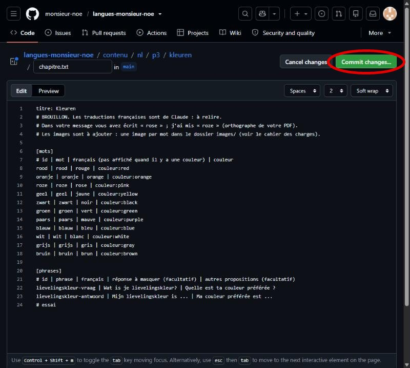
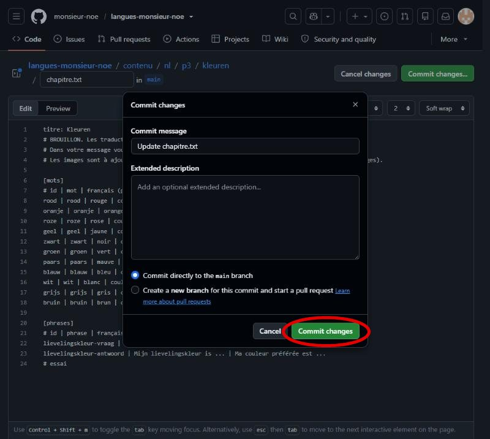
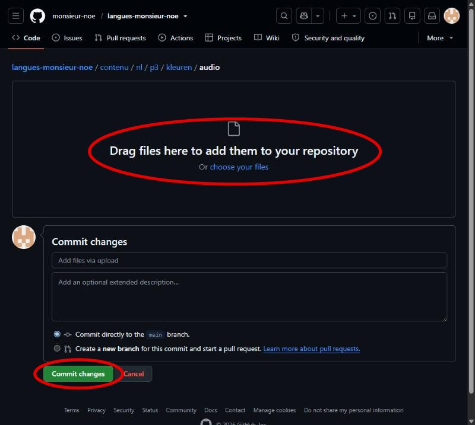
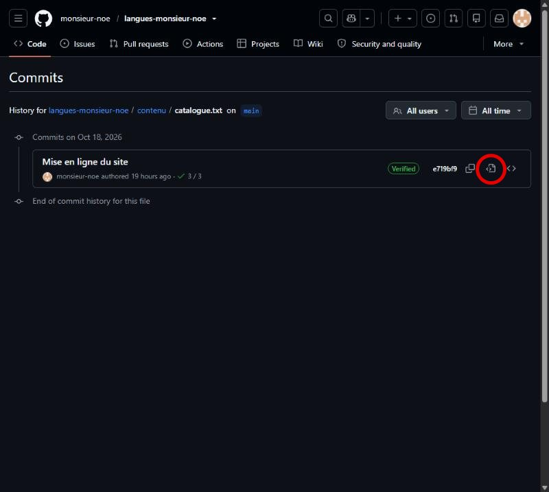
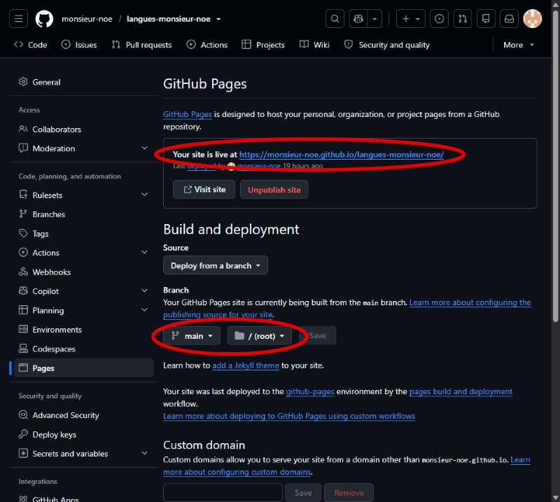

# Notice : faire vivre le site tout seul

Cette notice explique comment modifier le site « Les langues avec Monsieur Noé ». Pas de code à écrire : vous ne modifiez que des fichiers texte, des sons et des images.

**Les adresses à garder sous la main**

- Le site : https://monsieur-noe.github.io/langues-monsieur-noe/
- La page de contrôle (pour vous seul) : https://monsieur-noe.github.io/langues-monsieur-noe/controle/
- Le dépôt sur GitHub (là où sont rangés les fichiers) : https://github.com/monsieur-noe/langues-monsieur-noe

**Quelques mots de vocabulaire**

- **Dépôt** : le dossier en ligne qui contient tous les fichiers du site.
- **Commit** : un enregistrement. GitHub garde une copie de chaque version : vous pouvez toujours revenir en arrière.
- **Push** : l'envoi de vos enregistrements vers GitHub (avec GitHub Desktop).
- **main** : le nom de la version publiée du site. Laissez toujours `main`.

**Deux façons de modifier le site**

- **La page web de GitHub**, dans votre navigateur : pour une petite correction (un mot, une phrase, un ou deux sons). Voir la partie 2 A.
- **GitHub Desktop**, le logiciel installé sur votre ordinateur : pour tout le reste (un chapitre entier, beaucoup de sons ou d'images, déplacer des fichiers). La page web refuse plus de 100 fichiers à la fois. Voir la partie 2 B.

**La règle d'or : après chaque modification**

1. Attendez **5 minutes** : GitHub met ce temps à publier.
2. Rechargez le site. Si rien n'a changé, voir la partie 9 (« Le site ne change pas »).
3. Ouvrez la **page de contrôle** et vérifiez que votre chapitre a une pastille ✔ (voir la partie 6).

---

## 1. Ce que vous pouvez modifier, et ce qu'il ne faut jamais toucher

Vous ne modifiez que le dossier **`contenu/`**. Tout le reste fait fonctionner le site : n'y touchez pas.

| Dossier ou fichier | Vous pouvez y toucher ? |
|---|---|
| `contenu/` : les chapitres, les sons, les images | **Oui** |
| `pages/parents.html` et `pages/confidentialite.html` | Rarement, seulement pour corriger une phrase |
| `index.html`, `chapitre.html`, `css/`, `js/`, `polices/`, `controle/`, `notice/` | **Non** |
| `.nojekyll` | **Non, et ne le supprimez jamais** |

Dans le dossier `contenu/` :

- `catalogue.txt` : la liste des chapitres affichés sur l'accueil.
- `accueil.txt` : la ligne « Hello! | Hallo! | Bonjour! » de l'accueil.
- `_modele/chapitre.txt` : un chapitre vide et expliqué, à copier pour en créer un nouveau. **Toutes les possibilités d'un chapitre y sont décrites**, avec un exemple.
- `avatar/` : vos dessins de l'avatar.
- `nl/p3/<chapitre>/` : un dossier par chapitre. Dedans : `chapitre.txt` (les mots), `audio/` (les sons), `images/` (les images, si vous en avez), et le dessin du monstre.

Les règles d'écriture des fichiers `.txt` :

- Les colonnes sont séparées par `|`, avec une espace de chaque côté.
- Une ligne qui commence par `#` est une note pour vous : le site l'ignore.
- Les lignes vides sont ignorées.
- Les noms de fichiers et les identifiants : **minuscules, sans accent, sans espace**, avec des tirets (`te-voet`, `kleren-1`).
- Un identifiant ne change plus une fois publié.

## 2. Enregistrer une modification

### A. Par la page web de GitHub (petite correction)

Connectez-vous d'abord à GitHub (bouton « Sign in » en haut à droite), avec votre mot de passe et votre application de double authentification.

1. Ouvrez le fichier avec son lien de modification, par exemple pour « Kleuren » :
   https://github.com/monsieur-noe/langues-monsieur-noe/edit/main/contenu/nl/p3/kleuren/chapitre.txt
   (remplacez `kleuren` par le nom du dossier d'un autre chapitre).
2. Cliquez à l'endroit voulu et écrivez.
3. Cliquez sur le bouton vert **« Commit changes... »** en haut à droite.

   

4. Une fenêtre s'ouvre. Laissez tout tel quel (« Commit directly to the main branch » reste coché) et cliquez sur **« Commit changes »**.

   

5. Règle d'or : 5 minutes, puis la page de contrôle.

Si vous travaillez aussi avec GitHub Desktop, pensez ensuite à y cliquer sur « Fetch origin » puis « Pull origin » (partie 2 B, étape 1) : sinon votre ordinateur garde l'ancienne version.

### B. Avec GitHub Desktop (chapitre entier, beaucoup de fichiers)

Sur votre ordinateur, le site est rangé dans le dossier **`langues-monsieur-noe`**. C'est une copie du dépôt : vous y travaillez comme dans n'importe quel dossier (copier, coller, renommer), puis GitHub Desktop envoie vos changements.

1. **Avant de commencer** : ouvrez GitHub Desktop et cliquez sur **« Fetch origin »** en haut. S'il devient **« Pull origin »**, cliquez encore dessus : votre ordinateur reçoit les modifications faites sur la page web.

2. Ouvrez le dossier : menu **Repository**, puis **Show in Explorer**. Le dossier `langues-monsieur-noe` s'ouvre.
3. Faites vos changements dans `contenu/` :
   - un fichier `.txt` : clic droit, **Ouvrir avec**, **Bloc-notes** ; modifiez, puis **Ctrl** + **S** pour enregistrer ;
   - des sons ou des images : copiez-les dans le bon dossier (partie 4).
4. Revenez dans GitHub Desktop. À gauche, la liste montre les fichiers changés. Vérifiez qu'elle ne contient que vos changements (sinon, voir la partie 9).
5. En bas à gauche, écrivez une phrase courte dans le champ **« Summary »**, par exemple `Ajout du chapitre Kleren`, puis cliquez sur le bouton bleu **« Commit to main »** (il peut dire « Commit 12 files to main »).

6. Cliquez sur **« Push origin »** (en haut, ou le bouton bleu au milieu). Tant que ce n'est pas fait, rien n'est en ligne.

7. Règle d'or : 5 minutes, puis la page de contrôle.

Le site sur votre ordinateur ne s'ouvre pas en double-cliquant sur `index.html` : regardez toujours le résultat sur le site en ligne.

## 3. Corriger ou ajouter un mot ou une phrase

Exemple : le chapitre « Kleuren », fichier `contenu/nl/p3/kleuren/chapitre.txt`.

- **Corriger** : changez le mot ou le français. Ne changez pas l'identifiant (la 1re colonne).
- **Ajouter un mot** : ajoutez une ligne sous `[mots]`, par exemple :
  `pet | de pet | la casquette`
- **Ajouter une phrase** : ajoutez une ligne sous `[phrases]`, par exemple :
  `p3 | Ik draag een rode pet. | Je porte une casquette rouge. | rode`

Enregistrez (partie 2), puis ajoutez le son du nouveau mot (partie 4), sous le nom `<identifiant>.m4a`, par exemple `pet.m4a`. Sans son, le mot s'affiche quand même, simplement sans haut-parleur.

## 4. Ajouter ou remplacer un son ou une image

Il suffit de déposer le fichier, **au bon nom, dans le bon dossier**. Si un fichier du même nom existe déjà, il est remplacé.

**Le nom du fichier**

- Un son : `<identifiant>.m4a`, par exemple `rood.m4a` pour la ligne `rood | rood | rouge`. Format `.m4a` uniquement, 100 Ko au plus pour un mot.
- Une image : `<identifiant>.png`, par exemple `pet.png`. Une image en `.svg` ou `.webp` marche aussi, mais il faut alors écrire son nom dans la 4e colonne du mot (`pet | de pet | la casquette | pet.svg`). Taille : 600 × 600 pixels et 80 Ko au plus, fond uni, sans texte dans l'image.

**Le bon dossier**

- Les sons : `contenu/nl/p3/<chapitre>/audio/`
- Les images : `contenu/nl/p3/<chapitre>/images/` (créez le dossier s'il n'existe pas : clic droit, **Nouveau**, **Dossier**).

**Avec GitHub Desktop** : copiez les fichiers dans le bon dossier de `langues-monsieur-noe`, puis « Commit to main » et « Push origin » (partie 2 B).

**Par la page web** (un ou deux fichiers) :

1. Ouvrez la page d'envoi du dossier, par exemple pour les sons de « Kleuren » :
   https://github.com/monsieur-noe/langues-monsieur-noe/upload/main/contenu/nl/p3/kleuren/audio
   (pour les images : remplacez `audio` par `images` ; pour un autre chapitre, remplacez `kleuren`).
2. Faites glisser les fichiers depuis votre ordinateur dans le grand cadre de la page.
3. Attendez que leur nom apparaisse sous le cadre, puis cliquez sur le bouton vert **« Commit changes »** en bas.

   

4. Règle d'or : 5 minutes, puis la page de contrôle.

Un son enregistré en un seul long fichier (tous les mots à la suite) doit être découpé en un fichier par mot : demandez à Claude.

**Le monstre du jeu « Le combat de boss »**

- Son nom : la ligne `boss:` en haut du `chapitre.txt`, avant `[mots]`, par exemple `boss: Gribouille`. Sans cette ligne, il s'appelle « le monstre ».
- Son dessin : `boss.svg` (ou `boss.png`), directement dans le dossier du chapitre (pas dans `images`), carré, fond transparent, 60 Ko au plus. Sans dessin, une forme violette simple le remplace.
- Sa version en colère, pour « Le combat de boss difficile » : `boss-difficile.svg` (ou `boss-difficile.png`), au même endroit. Sans elle, le site assombrit le dessin de base et l'entoure d'un halo rouge.
- Le décor du combat (facultatif) : deux images JPG dans le dossier `contenu/arene/`, par exemple `couleurs.jpg` et `couleurs-difficile.jpg`, et la ligne `arene: couleurs` dans `chapitre.txt`. Noms en minuscules, sans accent ni espace. Demandez à Claude Code de les alléger avant de les déposer (une image de Gemini pèse près de 1 Mo).
- Vos poses pour le combat, `attaque` et `aie`, vont avec les autres poses de l'avatar dans `contenu/avatar/`. Sans elles, le site prend « pointe » et « reflechit ».

## 5. Ajouter un chapitre complet

Faites-le avec **GitHub Desktop** (partie 2 B) : un chapitre compte souvent plus de 100 fichiers. Exemple : un chapitre « Kleren » pour la P3.

1. GitHub Desktop : **« Fetch origin »** (et « Pull origin » s'il apparaît), puis **Repository**, **Show in Explorer**.
2. Choisissez **le nom du dossier** : minuscules, sans accent, tirets. Ici : `kleren`.
3. Dans `contenu/nl/p3/`, créez le dossier `kleren`. Copiez-y le fichier `contenu/_modele/chapitre.txt`.
4. Ouvrez `kleren/chapitre.txt` avec le Bloc-notes et remplissez-le en lisant ses notes :
   - `titre:` le titre du chapitre, par exemple `titre: Kleren`.
   - sous `[mots]` : une ligne par mot. Au moins 4 mots ; 8 à 30 c'est mieux.
     `broek | de broek | le pantalon`
     `hemd | het hemd | la chemise`
     Pour un nom, écrivez l'article (`de` ou `het`) : l'exercice « De ou het ? » se crée tout seul.
   - `[phrases]`, `[pistes]`, `[dictees]`, `[ordre]` : facultatifs. Laissez-les vides si vous n'en avez pas.
   - Vous pouvez effacer les lignes d'exemple qui commencent par `#`, ou les garder : le site les ignore.
5. Créez le dossier `kleren/audio` et copiez-y les sons, un fichier par mot, nommé comme l'identifiant : `broek.m4a`, `hemd.m4a`…
6. Ouvrez `contenu/catalogue.txt` et ajoutez une ligne à la fin :
   `nl | p3 | kleren | 6 | Kleren`
   Dans l'ordre : langue (`nl`), année (`p3` ou `p4`), nom du dossier (exactement le même qu'à l'étape 2), place dans la liste, titre affiché.
7. GitHub Desktop : **« Commit to main »**, puis **« Push origin »**.
8. Règle d'or : 5 minutes, puis la page de contrôle. Ensuite, ouvrez le chapitre sur le site et essayez toutes les rubriques.

Les images viennent plus tard, quand vous les avez (partie 4). En attendant, les cartes montrent le français.

**Les possibilités en plus** (toutes facultatives, expliquées avec un exemple dans `contenu/_modele/chapitre.txt`) :

- `quizlet:` : le lien Quizlet ; plusieurs listes : une ligne par liste, `quizlet: Les mois | https://quizlet.com/...`
- `note_parents:` : un conseil pour les parents.
- `couleurs:` : l'exercice « Couleurs », avec les couleurs d'un autre chapitre.
- `boss:` : le nom du monstre (partie 4).
- `liste: Les mois` dans `[mots]` : range les mots qui suivent dans une liste de « Je découvre ». Dans `[phrases]`, avec **exactement le même nom**, elle range les phrases avec cette liste.
- `dates | Les dates | dates:` dans `[dictees]` : une dictée de dates tirées au hasard (il faut les jours, les mois et les nombres de 1 à 31 dans `[mots]`, avec leur son).
- `[ordre]` : le jeu « Mots en ordre », une ligne par manche ; la 4e colonne donne un intrus (un mot en trop à laisser de côté).

## 6. Vérifier votre travail avec la page de contrôle

Ouvrez **https://monsieur-noe.github.io/langues-monsieur-noe/controle/**

Cette page n'est liée nulle part sur le site : les élèves ne la voient pas. Elle relit tous les chapitres et met une pastille à chacun :

- **✔** : tout va bien.
- **⚠** : le site marche, mais il manque quelque chose (un son, une image, un exercice qui n'est pas proposé). Lisez la phrase : elle dit quoi faire.
- **✖** : une erreur empêche le chapitre de s'afficher correctement. La page donne le fichier, le numéro de ligne et la correction.

Les messages les plus fréquents :

- « il manque une colonne » : une ligne n'a pas assez de `|`. Allez à la ligne indiquée et comparez-la aux autres.
- « trouvé audio/Rood.m4a : renomme-le en rood.m4a » : le nom a une majuscule. Renommez-le (partie 9, « Un fichier au mauvais endroit ou mal nommé »).
- « trouvé audio/rood.mp3 : ce format n'est pas accepté » : le son n'est pas en `.m4a`. Demandez à Claude de le convertir.
- « fichier introuvable » : vérifiez les majuscules, les accents, les espaces et l'extension du nom.
- « Texte à trous : il faut au moins 2 propositions fausses » : écrivez de fausses réponses en 5e colonne de la phrase, séparées par des virgules. Ce n'est pas grave si vous ne le faites pas : l'exercice n'est simplement pas proposé.
- « Le fichier … chapitre.txt est introuvable » : le nom du dossier écrit dans `catalogue.txt` n'est pas exactement le même que le vrai dossier.

La page montre aussi, pour chaque chapitre, les **mots secrets** des 7 derniers jours, et le bouton **« Copier pour Quizlet »**.

## 7. Annuler une erreur : revenir à la version précédente

**Pas encore envoyé (avant « Push origin »)**

- Un fichier modifié par erreur : dans GitHub Desktop, clic droit sur le fichier dans la liste de gauche, **« Discard changes... »**, puis confirmez. Le fichier redevient comme avant.
- Un « Commit to main » fait trop vite : en bas à gauche, cliquez sur **« Undo »**. Vos changements restent, rien n'est perdu.

**Déjà en ligne**

Dans GitHub Desktop, onglet **« History »** à gauche : la liste montre chaque enregistrement, le plus récent en haut. Clic droit sur celui qui a causé l'erreur, **« Revert changes in commit »**, puis **« Push origin »**. Le site revient à la version d'avant ce changement.

Pour retrouver un seul fichier tel qu'il était à une date, la page web est plus simple :

1. Ouvrez l'historique du fichier. Exemple pour le catalogue :
   https://github.com/monsieur-noe/langues-monsieur-noe/commits/main/contenu/catalogue.txt
   (pour un autre fichier, remplacez la fin de l'adresse par son chemin).
2. Repérez l'enregistrement **d'avant** votre erreur. Sur sa ligne, à droite, cliquez sur l'icône « < > » (« View code at this point ») : le fichier s'affiche tel qu'il était ce jour-là.

   

3. Au-dessus du texte, à droite, cliquez sur l'icône **« Copy raw file »** (deux petits carrés) : l'ancienne version est copiée.
4. Ouvrez le fichier actuel en modification (partie 2 A), sélectionnez tout le texte (**Ctrl** + **A**), collez (**Ctrl** + **V**), puis **« Commit changes... »** et **« Commit changes »**.

## 8. Faire une sauvegarde complète

Une fois par trimestre, ou avant un gros changement :

1. Cliquez sur ce lien : https://github.com/monsieur-noe/langues-monsieur-noe/archive/refs/heads/main.zip
2. Un fichier `langues-monsieur-noe-main.zip` se télécharge. Il contient tout le site.
3. Rangez-le chez vous (clé USB ou disque), avec la date dans le nom, par exemple `site-2026-12-20.zip`.

Gardez aussi vos enregistrements d'origine chez vous : ils ne sont pas dans le dépôt.

## 9. Les problèmes courants

**Le site ne change pas**

1. Attendez 5 minutes de plus : la publication peut être lente.
2. Rechargez la page sans mémoire : **Ctrl** + **F5** (sur téléphone : fermez l'onglet et rouvrez le site).
3. Ouvrez https://github.com/monsieur-noe/langues-monsieur-noe/actions : la ligne du haut, « pages build and deployment », montre une coche verte quand la publication est finie, un rond jaune quand elle est en cours, une croix rouge si elle a échoué (attendez 10 minutes, puis demandez à Claude).
4. Avec GitHub Desktop : vérifiez que vous avez bien cliqué sur « Push origin » (partie 2 B, étape 6).

**GitHub Desktop : « Push origin » n'apparaît pas**

- Il n'y a rien à envoyer : vous n'avez pas encore cliqué sur « Commit to main », ou tout est déjà en ligne.
- La liste de gauche est vide alors que vous avez changé un fichier : vous l'avez changé ailleurs que dans le dossier `langues-monsieur-noe` (par exemple une copie sur le bureau). Recopiez-le au bon endroit.

**GitHub Desktop affiche « Pull origin »**

Des modifications ont été faites sur la page web et votre ordinateur ne les a pas encore. Cliquez sur **« Pull origin »** avant tout « Commit ». Si un message parle de **conflit** (« conflict ») ou propose de mettre vos changements de côté (« stash »), arrêtez-vous et demandez à Claude : rien n'est perdu.

**GitHub Desktop demande de se connecter**

La connexion a expiré. Menu **File**, **Options**, **Accounts**, **Sign in**, puis suivez les étapes dans votre navigateur (mot de passe et double authentification).

**GitHub Desktop montre beaucoup plus de fichiers que prévu**

Par exemple des fichiers de `js/` ou `css/`, ou des centaines de sons que vous n'avez pas touchés. Ne cliquez pas sur « Commit » : demandez à Claude. Si vous êtes sûr de n'avoir rien voulu changer dans un fichier, clic droit dessus, « Discard changes... ».

**Un fichier au mauvais endroit ou mal nommé**

Par exemple un son tout seul à la racine du dépôt, à côté de `index.html`, ou un nom avec une majuscule (`Rood.m4a`).

1. GitHub Desktop : « Fetch origin » (et « Pull origin »), puis **Repository**, **Show in Explorer**.
2. Dans le dossier, faites glisser le fichier au bon endroit, ou renommez-le (clic droit, **Renommer**).
3. GitHub Desktop : le fichier apparaît deux fois (l'ancien rayé, le nouveau). « Commit to main », puis « Push origin ».

**Une erreur dans `chapitre.txt`**

La page de contrôle donne la ligne. Les erreurs les plus fréquentes :

- Un `|` manquant ou en trop : comparez la ligne avec ses voisines.
- Une ligne `titre:`, `quizlet:`, `boss:`, `couleurs:` ou `note_parents:` placée sous `[mots]` : ces lignes vont en haut du fichier, avant `[mots]`.
- Un lien Quizlet de plus d'une liste sans son nom : il faut `quizlet: Les mois | https://...`.
- Une ligne `liste:` de `[phrases]` dont le nom n'est pas exactement celui de `[mots]` (majuscules, accents) : les phrases n'apparaissent pas avec leur liste.
- Un intrus dans `[ordre]` sans son : écrivez `| |` avant l'intrus, par exemple `zin-1 | Ik / ben / blij | | stoel`.
- Un `#` oublié au début d'une ligne d'exemple du modèle : le site la prend pour un vrai mot.

En cas de doute, comparez avec l'exemple de `contenu/_modele/chapitre.txt`.

## 10. Si le site ne s'affiche plus, ou si GitHub change ses conditions

**Le site ne s'affiche plus**

1. Attendez 10 minutes et rechargez : une publication est peut-être en cours.
2. Ouvrez la page de contrôle : une ✖ indique souvent la cause.
3. Vérifiez que la publication est toujours active : https://github.com/monsieur-noe/langues-monsieur-noe/settings/pages
   Vous devez y voir « Your site is live at… », et sous « Branch » : `main` et `/ (root)`. Ne cliquez jamais sur le bouton rouge « Unpublish site » : il retire le site d'internet.

   

4. Si une modification récente a tout cassé, annulez-la (partie 7).
5. Sinon, demandez de l'aide (partie 11).

**Une fois par an (par exemple à la rentrée)**

- Vérifiez que GitHub Pages est toujours gratuit pour un dépôt public : cherchez « GitHub Pages limits » ou demandez à Claude. Le site est très petit, loin des limites.
- Faites une sauvegarde (partie 8).

**Changer d'hébergeur**

Le site est fait pour déménager facilement : c'est un simple dossier de fichiers. Avec la sauvegarde ZIP, un autre hébergeur gratuit de « site statique » (par exemple Cloudflare Pages) peut le publier tel quel, sans rien modifier. Demandez à Claude de vous guider pas à pas.

**Réinstaller GitHub Desktop ou changer d'ordinateur** : demandez à Claude. La copie du dépôt a besoin de deux réglages spéciaux (un son s'appelle `nul.m4a`, un nom que Windows refuse d'habitude).

## 11. Quand demander de l'aide

Vous faites seul : ajouter ou corriger un mot, une phrase, un son, une image, un chapitre ; annuler une erreur ; sauvegarder.

Demandez à Claude (ou à une personne qui code) pour :

- un nouveau type d'exercice, ou un changement de design (couleurs, disposition, boutons) ;
- découper un long enregistrement en un son par mot, ou convertir un son qui n'est pas en `.m4a` ;
- une ✖ que vous ne comprenez pas sur la page de contrôle ;
- un conflit dans GitHub Desktop, ou des fichiers changés que vous ne reconnaissez pas ;
- un site qui ne s'affiche plus malgré la partie 10 ;
- l'anglais, une nouvelle année (P5, P6), les vidéos YouTube, ou l'avatar.

Quand vous demandez de l'aide, donnez : l'adresse de la page, ce que vous avez fait juste avant, et le message de la page de contrôle.
